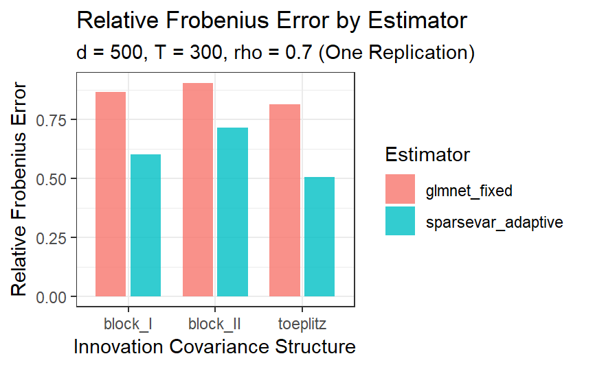

## Abstract

High-dimensional time-series data present challenges for traditional regression methods, specifically when the number of predictors exceeds the number of observations and the observations exhibit temporal dependence. Basu and Michailidis (2015) investigated the theoretical properties of LASSO regularization for estimating sparse vector autoregressive (VAR) models under stability and sparsity assumptions. This report investigates how accurately LASSO recovers the true transition matrix under different innovation covariance structures. A VAR(1) simulation was conducted with 500 variables, 300 time-series observations, and approximately 99% sparsity among off-diagonal coefficients. Two estimation procedures were compared: fixed LASSO with $\lambda=0.05$ and time-slice-tuned LASSO. Estimation accuracy was evaluated using relative Frobenius error, precision, recall, and F1-score across Block-I, Block-II, and Toeplitz covariance structures. Preliminary results indicate that time-slice-tuned LASSO achieved lower relative Frobenius error and higher F1-scores across all three structures. However, these findings are based on only one Monte Carlo replication per covariance structure. Future work will investigate additional replications, lower-dimensional settings, varying innovation correlations, and comparisons with multi-VAR models.

## Introduction

Data can be challenging to analyze due to factors such as missing observations, small sample sizes, high dimensionality, and dependence between observations. In traditional regression settings, we often consider low-dimensional data, where the number of observations is much larger than the number of predictors ($n \gg p$). Under the  appropriate assumptions, a statistician may consider an ordinary least squares (OLS) regression to estimate the relationship between predictors and a response variable. However, what happens when the data being considered is high-dimensional, where the number of predictors exceeds the number of observations ($p \gg n$)? In these settings, the OLS estimator may not be uniquely determined as the design matrix does not have full column rank. Furthermore, what if the observations are not identically independently distributed, as is commonly seen in time-series data?

Consider the example of gene expression data, where the expression levels of multiple genes are measured over time. The expression level of a particular gene at the current time point may depend on its previous expression levels, as well as the previous expression levels of other genes. The temporal relationships between the variables can be modeled using vector autoregressive (VAR) models. However, as the number of variables increase, the number of parameters that need to be estimated grows rapidly. Having the number of parameters grow rapidly leads to estimation becoming a challenge when the sample size is limited.

To address these challenges, Basu and Michailidis (2015) investigated regularized estimation methods for sparse high-dimensional time-series models. Their work examines how LASSO ($\ell_1$-regularization) can be used to estimate transition matrices in stable VAR models, even when observations show temporal dependence. By assuming that the transition matrices are sparse, meaning that most coefficients are zero, LASSO can reduce the number of nonzero estimated coefficients while maintaining predictive relationships between variables. The authors also establish theoretical estimation error bounds and show how the dependence structure of the time series influences estimation accuracy.

This project investigates how accurately LASSO can recover the true transition matrix in a sparse VAR(1) model under different innovation covariance structures. Specifically, this project compares fixed LASSO with time-slice-tuned LASSO by using the time ordering of the observations to examine how the choice of regularization affects estimation accuracy and coefficient support recovery.

## Method

Suppose we have a $p$-dimensional vector-valued time series $\{Y_t\}$, where $Y_t=(Y_t^1,\dots,Y_t^p)^\top$. This project focuses on the sparse VAR(1) model,

$$
Y_t = AY_{t-1}+\epsilon_t, \qquad
\epsilon_t \overset{i.i.d.}{\sim} N_p(\mathbf{0},\Sigma_\epsilon),
$$

where $A\in\mathbb{R}^{p\times p}$ is the transition matrix and $\epsilon_t$ is a $p$-dimensional vector of possibly correlated innovation shocks. Each coefficient $a_{ij}$ represents how the previous value of variable $j$ contributes to predicting the current value of variable $i$, holding the other lagged variables constant. The goal is to estimate $\widehat A\approx A$, where each estimated coefficient $\widehat a_{ij}$ approximates its corresponding true coefficient $a_{ij}$.

The model assumes linearity, sparsity in the transition matrix $A$, and Gaussian Innovations that are independent over time but may be correlated across varaibles. Stability requires $\rho(A) <1$, while the innovation covariance matrix must be positive definite. Under these conditions, the model admits a stationary solution. Sparisity assumes that only a small proportion of $p^2$ coefficientsss are nonzero, allowing regularized estimation in high-dimensional settings. 

An important observation is that sparse VAR does not require the observations $Y_t$ to be independent over time. Instead, temporal dependence is captured by the transition matrices. Although the innovations are independent across time, their components may be correlated, meaning that $\Sigma_\epsilon$ does not need to be diagonal. The low-dimensional structure of the sparse VAR model comes from sparsity in the transition matrices rather than the observed data being low-dimensional. Although a VAR($d$) model has $dp^2$ possible coefficients, only $k$ are assumed to be nonzero. This structure allows regularized estimation methods to recover the transition matrices in high-dimensional settings under the appropriate stability, sparsity, and sample size conditions. 

In sparse VAR models, there are two types of errors to consider. The first is the innovation error $\epsilon_t$, which represents random noise in the data-generating process. The second is the estimation error, which measures how accurately the estimated transition matrix recovers the true matrix. 

In this specific simulation, we evaluate estimation accuracy using the relative Frobenius error,
$$
\frac{\lVert\widehat A-A\rVert_F}{\lVert A \rVert_F}.
$$

This normalizes the estimation error by the magnitude of the true transition matrix. A smaller relative error implies more accurate coefficient recovery. We also evaluate support recovery using precision, recall, and F1-score to determine how accurately the estimators identify the nonzero entries of $A$.

Basu and Michailidis (2015) also investigate the theoretical properties of $\ell_1$-regularized least squares, also known as LASSO, for estimating sparse VAR transition matrices. For VAR(1), the estimator can be written as

$$
\hat{A} = \arg\min_{B \in \mathbb{R}^{p \times p}}
\left\{
\frac{1}{N}\sum_{t=1}^{N}
\left\lVert Y_t - BY_{t-1} \right\rVert_2^2
+ \lambda_N \sum_{i=1}^{p}\sum_{j=1}^{p}|b_{ij}|
\right\}
$$
where $N$ is the number of usable observations, $B$ is a candidate transition matrix, and $\lambda_N$ is the regularization parameter.

The first term measures the discrepancy between the observed and predicted values, while $ell_1$ penalty encourages sparsity by shrinking coefficients towards zero. The regularization parameter $\lambda$ control the degree of the shrinkage, with larger values producing sparser estimates but potentially introducing greater estimation bias. This allows LASSO to estimate sparse transition matrices when the number of parameters exceeds the available observations.

Thus, LASSO estimates the transition matrix by balancing prediction accuracy and sparsity. Instead of estimating all $p^2$ coefficients without restriction, LASSO encourages a smaller number of nonzero coefficients, which is useful when the number of variables is large relative to the number of observations.

For this simulation, row wise estimation is used for the fixed LASSO using $\texttt{glmnet}$, which is defined as 
$$
\hat{a_i} = \arg_a \min \left \{ \frac{1}{2N} \sum_{t=2}^N(Y_{ti} - b^{\top}Y_{t-1})^2 + \lambda\lVert b \rVert_1\right\} \quad \lambda=0.05
$$
The second estimation method uses the $\texttt{sparsevar}$ package to estimate VAR(1) transition matrix with an $\ell_1$ penalty, where the regularization parameter is selected using time-slice validation with 10 held-out observations. Both procedures estimate the same transition matrix but differ in implementation and how the regularization parameter is chosen. 

Under the conditions established by Basu and Michailidis (2015), a theoretically sufficient penalty satisfies

$$
\lambda_N >
4Q(\beta^*,\Sigma_\epsilon)
\sqrt{\frac{\log d+2\log p}{N}},
$$

where $Q(\beta^*,\Sigma_\epsilon)$ reflects the dependence structure and innovation covariance. When the dependence-related constants remain controlled, the regularization parameter has the order

$$
\lambda_N\asymp\sqrt{\frac{\log(dp^2)}{N}}.
$$

This theoretical choice helps establish estimation-error bounds for the sparse VAR model. In the numerical simulations, we compare a fixed LASSO estimator with $\lambda=0.05$ against a time-slice-tuned LASSO estimator to investigate how the choice of regularization affects estimation accuracy and support recovery.

## Numerical Simulations

To evaluate the performance of sparse VAR(1) estimation, a simulation was conducted with $p=500$ variables and $T=300$ time-series observations. The true transition matrix $A$ was generated with approximately $99\%$ of its off-diagonal coefficients set to zero, and its spectral radius was scaled to $0.8$ to ensure stability. A fixed LASSO with a regularization parameter of $\lambda=0.05$ and time-slice-tuned LASSO, which selects the regularization parameter using time-slice validation were compared in this simulation.

To investigate how correlation among innovations affects estimation accuracy, the three covariance structures were considered were Block-I, Block-II, and Toeplitz. The correlation parameter was fixed at $\rho=0.7$. The same true transition matrix $A$ was used across all three covariance structures so that the differences in estimation accuracy could be examined while keeping the underlying coefficients fixed. Each covariance structure was evaluated using one Monte Carlo replicatio and the primary performance measures were relative Frobenius estimation error, precision, recall, and F1-score. From the simulation, we get

\begin{table}[htbp]
\centering
\small
\caption{Estimation accuracy and support recovery for sparse VAR(1) under different innovation covariance structures ($p=500$, $T=300$, $\rho=0.7$).}
\label{tab:simulation_results}
\begin{tabular}{llrrrrrr}
\hline
Method & Covariance & $\rho$ & Rel. Error & MSE & Precision & Recall & F1 \\
\hline
Fixed LASSO & Block-I & 0.7 & 0.864 & 0.0005 & 0.0472 & 0.826 & 0.0894 \\
Fixed LASSO & Block-II & 0.7 & 0.904 & 0.0005 & 0.0650 & 0.732 & 0.1190 \\
Fixed LASSO & Toeplitz & 0.7 & 0.814 & 0.0004 & 0.0473 & 0.895 & 0.0898 \\
\hline
Time-slice LASSO & Block-I & 0.7 & 0.600 & 0.0002 & 0.2430 & 0.749 & 0.3670 \\
Time-slice LASSO & Block-II & 0.7 & 0.714 & 0.0003 & 0.2380 & 0.617 & 0.3440 \\
Time-slice LASSO & Toeplitz & 0.7 & 0.504 & 0.0002 & 0.2040 & 0.858 & 0.3300 \\
\hline
\end{tabular}

\vspace{0.2cm}
\parbox{0.95\textwidth}{
\footnotesize
\textit{Note.} Results are based on one Monte Carlo replication per
covariance structure. Smaller relative Frobenius error and MSE indicate
better coefficient estimation, while higher precision, recall, and F1
indicate better support recovery.
}
\end{table}

Block-I assumes equal pairwise correlation $\rho$ among the first half of the variables, with the remaining variables uncorrelated. Block-II divides the variables into two equally sized groups with within-group correlation $\rho$ and zero between-group correlation. The Toeplitz structure assumes $(\Sigma_{\epsilon})_{ij} = \rho^{|i-j|}$, allowing correlation to decrease with the distance between variables. All covariance structures have unit diagonal entries, and innovations remain independent across time.

The first goal was to investigate how the innovation covariance structure affects estimation accuracy within each estimator. The results show that Block-II produces the highest relative Frobenius error for both estimators, while Toeplitz produces the lowest. This suggests that the dependence structure of the innovations may influence how accurately the estimated transition matrix $\hat{A}$ recovers the true matrix $A$. Different forms of cross-sectional correlation appear to affect coefficient recovery differently, even when the true transition matrix remains unchanged. However, because these results are based on a single replication per covariance structure, they should be interpreted as preliminary observations rather than evidence of a consistent relationship.

The second objective was to compare the estimation accuracy of fixed LASSO and time-slice-tuned LASSO. Across all three covariance structures, time-slice-tuned LASSO achieved a lower relative Frobenius error than fixed LASSO. The paired comparisons show that the largest improvement occurred under the Toeplitz covariance structure, where the relative Frobenius error decreased by approximately $0.310$, while the smallest improvement occurred under Block-II, with a decrease of approximately $0.190$. These observations suggest that selecting the regularization parameter through time-slice validation may improve coefficient estimation compared with using a fixed value of $\lambda$. However, these results do not establish that time-slice-tuned LASSO will consistently outperform fixed LASSO across independently simulated datasets.

In addition to estimation error, each method was evaluated based on how accurately it recovered the nonzero entries of the true transition matrix. The support recovery analysis shows that fixed LASSO achieved higher recall but considerably lower precision than time-slice-tuned LASSO across all three covariance structures. This indicates that fixed LASSO identified a larger proportion of the true nonzero coefficients but also selected more false positives relative to its true positives. In contrast, time-slice-tuned LASSO achieved higher precision and F1-scores, suggesting a better balance between identifying true nonzero coefficients and avoiding unnecessary coefficients. The highest F1-score for time-slice-tuned LASSO occurred under Block-I, while fixed LASSO achieved its highest F1-score under Block-II. These comparisons illustrate that smaller estimation error does not necessarily imply higher recall, since estimation error and support recovery measure different aspects of coefficient recovery.

Overall, the preliminary numerical results suggest that time-slice-tuned LASSO may provide more accurate estimation of the transition matrix and better support recovery than fixed LASSO under the covariance structures considered. The results also suggest that the innovation covariance structure may influence estimation accuracy. However, additional simulations are necessary to determine whether these patterns persist across different correlation strengths, sample sizes, sparsity levels, and dimensional settings.

## Limitations and Future Steps

The primary limitation of this experiment is that only one Monte Carlo replication was conducted for each covariance structure, with $p=500, T=300, \&\  \rho =0.7$. Thus, the observed differences may reflect random variation rather than consistent estimator performance. Future simulations will increase the number of replications, examine lower dimensional settings ($p=10,30$), and vary innovation correlations $\rho \in \{0.5,0.7,0.9\}$ and sparsity levels. These experiments will allow estimation of average error, variability, and confidence intervals for paired estimator differences. Although a burn-in period of 200 observations was used, exact stationary initialization and sample size conditions required for theoretical guarantees have not been verified.

A further limitation is that this study relies entirely on simulated data. Since the true transition matrix $A$ is known in the simulation, coefficient recovery can be evaluated directly using relative Frobenius error. However, in real-world applications, the true transition matrix is generally unknown, meaning that relative Frobenius estimation error cannot be calculated directly. Instead, the estimators could be compared using out-of-sample forecasting errors.

One potential application of sparse VAR(1) is the GSE130811 gene-expression dataset, available through the National Center for Biotechnology Information Gene Expression Omnibus. This dataset contains RNA-seq measurements of Caenorhabditis elegans (C. elegans) collected hourly from 5 to 48 hours during larval development, providing 44 time-series observations. The dataset measures the expression levels of thousands of genes, including 3,739 genes identified by the original researchers as exhibiting oscillatory expression patterns. To prepare the data for sparse VAR(1) estimation, we first examined the dataset for missing values and normalized the RNA-seq counts using counts per million (CPM), followed by a log transformation. After filtering low-expression genes, 14,644 genes remained. We then selected the 100 genes with the highest sample variance during the training period to avoid using test observations during gene selection. Because the gene-expression trajectories exhibited substantial developmental changes, we applied first differencing, resulting in a dataset containing 43 observations and 100 genes. This produces a high-dimensional setting in which the number of predictors exceeds the available lagged observations. Preliminary diagnostics revealed substantial changes in gene-expression variability over time, raising concerns about the stationary assumption underlying VAR(1). 

Future work will also compare sparse VAR estimation with the multi-VAR framework proposed by Fisher et al. (2022), which decomposes individual transition matrices into shared and subject-specific effects. This comparison will involve simulating multiple time series with varying levels of between-subject heterogeneity. Separate LASSO estimation and joint multi-VAR estimation will be evaluated using relative Frobenius error, support recovery, and out-of-sample forecasting accuracy to investigate whether borrowing information across subjects improves estimation performance.
